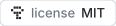

<div align="center">


# handle-mcp

<a href="https://modelcontextprotocol.io"></a>


<a href="LICENSE"></a>

**Your AI agent plans the week's meals on a budget, prices them at nemlig.com and BilkaToGo and fills the cheapest cart. You approve and pay.**

</div>

Danish grocery stores as an MCP server: [nemlig.com](https://www.nemlig.com) (home delivery) and [BilkaToGo](https://www.bilkatogo.dk) (home delivery or pickup) and [REMA 1000](https://shop.rema1000.dk) (pickup).

**It can never order or pay. You do.** That code does not exist, and a test fails if it shows up ([why](docs/adr/0001-the-human-always-pays.md)).

## How it works

1. **Plan.** Give your agent a budget. It reads this week's offers on nemlig.com, BilkaToGo and REMA 1000, and the stores' recipes, and plans the meals around them.
2. **Compare.** It prices the whole list in each store: pack sizes, offers, delivery fee and minimum order.
3. **Fill.** It puts the list in the cheapest store's cart, with your login. Only the cart, nothing else.
4. **Pay.** You open the store's website, check the cart, pick a delivery or pickup time and pay.

Taste, budget and meal rules live in your own prompt or skill. The server finds and counts. [Build your own skill](docs/skills.md).

## Requirements

- macOS, Linux or Windows, on x64 or ARM64. No Python or `uv` needed: the server is one binary.
- An MCP client, Grok, Claude Code, Claude Desktop or Codex etc.
- An account at nemlig.com (home delivery), BilkaToGo (home delivery or pickup) or REMA 1000 (pickup).

## Install

Download the archive for your system from [the v1.2.0 release](https://github.com/McAndersDK/handle-mcp-go/releases/tag/v1.2.0), unpack `handle-mcp` (`handle-mcp.exe` on Windows), and put it somewhere on PATH or remember its absolute path.

With Go 1.27.3 or newer:

```sh
go install github.com/McAndersDK/handle-mcp-go/cmd/handle-mcp@v1.2.0
```

Unsigned binaries: macOS and Windows may warn on the first run. See [setup](docs/setup.md).

## Try it

```sh
handle-mcp login nemlig
claude mcp add handle -- /absolute/path/to/handle-mcp
```

Then ask:

- *"Plan 5 dinners for 4 within 900 kr, built on this week's offers. Fill the cheapest cart."*
- *"What is on offer this week? Any free gifts?"*
- *"Which delivery times are cheapest tomorrow?"*

BilkaToGo, REMA 1000 (`handle-mcp login rema1000` also asks which stores you pick up in, in order of preference), Claude Desktop, headless machines and AI agents (`handle-mcp login <store> --from-env`): [setup](docs/setup.md). nemlig's offers work with no login at all.

## Tools

| Tool | Writes? | What |
|---|---|---|
| `search_products` | no | Price, price per kg/l, offers |
| `search_recipes` | no | The store's recipes (nemlig) |
| `list_recipes` | no | Featured recipes (BilkaToGo: the week's madplan), by tag (nemlig) or by category (BilkaToGo) |
| `get_recipe` | no | The products to buy for a recipe, for any number of persons |
| `list_offers` | no | This week's offers and free gifts |
| `compare_basket` | no | Prices a list in every store, fees included, cheapest first |
| `get_cart` | no | Cart lines, fees, total, in one store or every store |
| `set_cart_quantities` | **yes** | Sets quantities in the cart. Nothing else |
| `add_recipe_to_cart` | **yes** | Puts a recipe's products in the cart, after your yes. Nothing else |
| `get_delivery_info` | no | Chosen time, fees |
| `list_delivery_slots` | no | Free times, cheapest first |
| `get_orders` / `get_order` | no | What you usually buy |

Full arguments and fields: [docs/tools.md](docs/tools.md).

## More

[Setup](docs/setup.md) · [Skills](docs/skills.md) · [Security](docs/security.md) · [Troubleshooting](docs/troubleshooting.md) · [Testing](docs/testing.md) · [Roadmap](docs/roadmap.md) · [Contributing](CONTRIBUTING.md) · [Credits](CREDITS.md)

Unofficial. Uses the stores' private website APIs, so it can break any day. Not affiliated with nemlig.com or Salling Group.

A fork of [NJohansen/handle-mcp](https://github.com/NJohansen/handle-mcp), rewritten in Go. Credits: [CREDITS.md](CREDITS.md).

[MIT](LICENSE)
